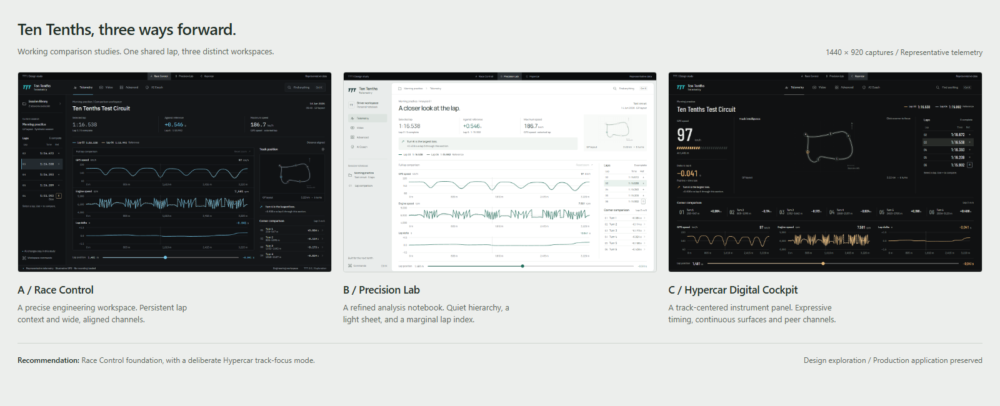

# Ten Tenths 2.0 — first design exploration

2026-11-03. Three runnable React explorations, developed on `design/ttt-premium-exploration` from clean `main` at `d6451bb`. This phase changes no production UI, backend, telemetry calculation, video synchronization or persistence behavior. No merge, release, push or native packaging was performed.

Start the local prototype from the repository root:

```sh
npm ci
npx vite --config prototypes/premium-ui/vite.config.ts
```

| Direction | Open prototype | Desktop screenshot | Minimum window |
|---|---|---|---|
| A — Race Control | [Open](http://127.0.0.1:4310/?direction=race) | [1440 × 920](screenshots/race-desktop.png) | [600 × 500](screenshots/race-compact.png) |
| B — Precision Lab | [Open](http://127.0.0.1:4310/?direction=lab) | [1440 × 920](screenshots/lab-desktop.png) | [600 × 500](screenshots/lab-compact.png) |
| C — Hypercar Digital Cockpit | [Open](http://127.0.0.1:4310/?direction=cockpit) | [1440 × 920](screenshots/cockpit-desktop.png) | [600 × 500](screenshots/cockpit-compact.png) |

All three include working lap/reference selection, speed/RPM/delta traces, linked GPS position, keyboard position slider, corner focus/reset, workspace navigation and command search. Representative telemetry comes from the existing synthetic demo generator. Other workspace destinations explicitly identify themselves as navigation previews; the full production workflows are preserved in the original app.

The signatures differ in structure: A puts stacked channel analysis beside a session explorer and track inspector; B places an analysis sheet inside a light notebook frame with a right-hand lap/corner index; C puts a track between instrument readouts and lap timing, then lays channels side by side. Typography and data color also differ, rather than simply recoloring one shell.

## Recommended direction



[Open the comparison board](comparison.html), or use the table above for full-size captures and the runnable studies.

Use **Race Control as the operational foundation**, with a restrained Hypercar track-focus mode and instrument typography. Its persistent lap explorer, wide aligned channels and nearby corner evidence fit TTT's existing functions best. Retain Precision Lab's hierarchy and measured spacing as the light-mode reference. This is a proposed synthesis, not a fourth implemented prototype or approval to migrate production.

| Criterion (subjective 1–5) | Race Control | Precision Lab | Hypercar |
|---|---:|---:|---:|
| Immediate visual impact | 4 | 4 | 5 |
| Motorsport identity | 5 | 3 | 5 |
| Professional usefulness | 5 | 5 | 4 |
| Interaction quality | 4 | 4 | 4 |
| Performance feasibility | 5 | 5 | 4 |
| Maintainability | 5 | 5 | 4 |
| Fit with existing TTT functionality | 5 | 4 | 4 |

Scores are design judgments after inspecting rendered screens, not user research or measured native performance. A's main compromise is density. B is calm and clear but has less motorsport character and spends more vertical space on framing. C is the most distinctive first impression; its narrow peer channels and large instruments make it better for track/corner review than sustained multi-channel work.

## Deliverables and evidence

- [Tooling setup and sign-in action](tooling.md): real shadcn/Playwright MCP initialization, personal UI UX Pro Max installation, Context7 queries, missing 21st authentication. Existing model/agent settings were preserved and semantically verified.
- [Current UI audit](audit.md) and eight `baseline-*.png` screenshots: actual React/uPlot/video components with synthetic IPC at desktop and the configured minimum size.
- [Reference/component research](research.md), [raw Pro Max recommendations](research/) and [design decisions](design-system.md): actual sources, dependencies and license/access limitations.
- [Runnable source and instructions](../../prototypes/premium-ui/README.md), [third-party notices](../../prototypes/premium-ui/THIRD_PARTY_NOTICES.md).
- [Phased migration roadmap](roadmap.md), [validation record](validation.md) and [machine-readable window checks](validation.json).

The browser validation covers synthetic prototype UI only. Native macOS WebKit, Windows WebView2, real recordings, playback and inference remain acceptance work for the implementation phase. At 600 × 500, secondary information moves below the fold with vertical scrolling; essential controls remain operable. Screenshots are exact viewport captures, not enlarged artboards.
